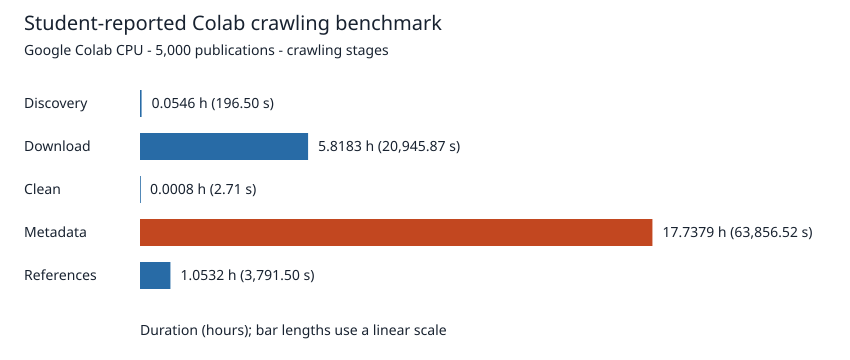

# Google Colab CPU Benchmark – 5,000 Papers

The student reports completing a new **Google Colab CPU run for 5,000 publications** and supplies the timing results below. The new run's raw logs and benchmark summaries are not available in the repository, so these are **student-reported full-corpus results**, not independently verified measurements. PSS values are previously measured Colab sample values, not full-run memory measurements. Historical Windows exports and corpus-quality statistics remain unchanged: **6,348 discovered versions**, **6,331 versions without download errors**, and **17 download errors**.

## Benchmark environment

| Metric | Value |
|---|---|
| Runtime | Google Colab CPU |
| Operating system | Linux x86_64 |
| Python | 3.13.18 |
| Logical CPUs | 2 |
| System RAM | 12.67 GiB |
| Memory metric | PSS |
| Sampling interval | 1 second |
| Parsing workers | 2 |
| Target publications | 5,000 |
| Discovered versions | 6,348 |
| Versions without download errors | 6,331 |

## Dataset 1 - Milestone 1 crawling

| Metric | Student-reported Colab full-corpus result |
|---|---:|
| Total papers | 5,000 |
| Discovered versions | 6,348 |
| Versions without download errors | 6,331 |
| Total crawling time | 88,793.10 s |
| Total duration | 24 h 39 min 53 s |
| Average time per paper | 17.7586 s (17.76 s) |
| Discovery | 196.50 s |
| Download | 20,945.87 s |
| Source cleanup | 2.71 s |
| Metadata collection | 63,856.52 s |
| References collection | 3,791.50 s |



Metadata accounts for approximately **71.9%** of reported crawling time, making it the main bottleneck. Downloading source files is the second most time-consuming stage. External API requests, network latency and rate limits influence crawling performance.

Measured Colab sample PSS: **55.60 MiB peak**, **37.79 MiB average**. No RAM time series is inferred from these two statistics.

Without a new benchmark summary to confirm storage measurements, the existing calculated sample-scaled estimates remain **1.0468 GiB corpus size** and **2.8533 GiB extra disk usage**. These are modeled values, not measured full-corpus storage or an observed disk peak. The historical actual Windows corpus size remains **2,643.05 MiB**, with its original scope (all retained files under publication folders).

The existing actual full-corpus reference statistics remain unchanged: **34.34** references returned per paper, **17.01** saved arXiv-linked references per paper, **100%** reference metadata success, **4,993** publications with successful Semantic Scholar records and **7** without records.

## Dataset 2 - Milestone 2 parsing

| Metric | Student-reported Colab full-corpus result |
|---|---:|
| Total papers | 5,000 |
| Parsing workers | 2 |
| Parsing wall time | 561.64 s |
| Parsing duration | 9 min 21.64 s |
| Average time per paper | 0.1123 s |

Measured Colab sample PSS: **41.42 MiB peak**, **31.02 MiB average**. These are separate from the historical Windows RSS measurements.

The actual Windows full-corpus statistics remain **5,000 publications processed**, **6,348 discovered versions**, **6,015 parsed versions**, **331 empty versions** (313 PDF-only, 17 missing source directory, 1 no TeX), and **2 failed versions**. There are **0 publication errors** and **0 missing publications**. The actual Windows parsing wall time remains **408.362 s**, peak RSS **989.85 MiB**, average RSS **867.92 MiB**, and parsed JSON size **1,012.74 MiB**.

Actual Windows deduplication reduced elements from **2,964,362** to **2,408,228** (**556,134 removed; 18.76%**), with **2,958,347 hierarchy rows**, and bibliography records from **744,894** to **510,849** (**234,045 removed; 31.42%**). Removing duplicate records improves data quality and reduces storage requirements. No separately verified Colab output counts are available, so these historical totals are preserved. Parsing processes local LaTeX sources without repeated external API requests; the reported Colab run uses two parallel workers.

## Dataset 3 - M2 table export

| Metric | Student-reported Colab full-corpus result |
|---|---:|
| Table export time | 50.80 s |
| Parsing time | 561.64 s |
| Parsing + export | 612.44 s |
| Combined duration | 10 min 12.44 s |

Parsing wall time excludes table export; **612.44 s** is the combined duration, not the parsing wall time.

The actual full-corpus Windows tables remain:

| Table | Rows | Size (MiB) |
|---|---:|---:|
| `elements.jsonl` | 2,408,228 | 585.51 |
| `hierarchy.jsonl` | 2,958,347 | 305.75 |
| `bibtex.jsonl` | 510,849 | 148.42 |
| **Total** | **5,877,424** | **1,039.68** |

(colab-per-paper)=
## Dataset 4 - Per-paper performance

These averages divide each reported full-corpus duration by **5,000 publications**, with rounding to four decimal places. They are not separately timed single-paper runs.

| Stage | Average time (s/paper) |
|---|---:|
| Discovery | 0.0393 |
| Download | 4.1892 |
| Clean | 0.0005 |
| Metadata | 12.7713 |
| References | 0.7583 |
| Total crawling | 17.7586 |
| Parsing | 0.1123 |
| Table export | 0.0102 |
| Parsing + export | 0.1225 |

The [summary table](crawling_stats.md#colab-summary) compares M1 and M2. The protocol below is retained for reproducibility; it is not executed when building the book.

The final testbed is specified by the [official M1 performance requirements](https://hcmus-cs-ta.github.io/lab-book/intro-ds/statement/crawling/) and [M2 report requirements](https://hcmus-cs-ta.github.io/lab-book/intro-ds/statement/parsing/).

## Executable workflow (recommended)

Open `notebooks/colab_cpu_benchmarks.ipynb` in Google Colab, select CPU-only runtime, and upload the reviewed checkout including `src/` and `scripts/`. The notebook contains no outputs and defaults to plan mode. Set its explicit opt-in only when ready for the complete assigned range.

The same runner can be reviewed locally without executing a benchmark:

```powershell
python scripts/colab_benchmark.py --stage both --workdir /content/arxiv-new-run --single-trial
```

On a genuine Colab CPU runtime, explicit execution is:

```python
!python /content/arxiv-code/scripts/colab_benchmark.py --stage both --workdir /content/arxiv-new-run --single-trial --workers 2 --execute
```

Supply `S2_API_KEY` privately first. Existing run paths are refused. M2-only mode accepts `--input-data` and copies it while excluding previous parse outputs; the input is never modified. The runner retains environment/source hashes, exact commands, logs, independent corpus-disk samples, full benchmark summaries, a separate single-paper trial and separately timed merged-table export. Offline fixture tests cover plan mode, CPU guards, isolated input copying and retained failure artifacts. Those tests are not Colab performance results.

Current archive-size statistics distinguish logical uncompressed member bytes (read from archive metadata without extracting unwanted files) from actual retained corpus bytes and sampled peak disk. Never label logical member sizes as measured temporary storage.

## 1. Prepare an isolated runtime

Choose **Runtime → Change runtime type → CPU** (hardware accelerator: None). Upload a reviewed copy of the project's `src/` directory to `/content/arxiv-code/src/`, or clone the reviewed code commit into `/content/arxiv-code`. Do not benchmark the unreviewed default branch: local code may not have been pushed yet.

Install only the pipeline dependencies; the report's Python 3.14 environment is separate from Colab's supplied interpreter:

```python
%pip install arxiv==4.0.2 requests==2.34.2 psutil==7.2.2
```

Create a new directory for each run. Never mount the original Windows corpus as writable benchmark storage. Run on Colab's local disk, and copy results to durable storage afterward.

```python
import hashlib, json, os, platform, shutil, subprocess, sys
from datetime import datetime, timezone
from pathlib import Path
import psutil

code = Path('/content/arxiv-code').resolve()
assert (code / 'src/benchmark.py').exists()
assert os.environ.get('COLAB_GPU', '0') in ('0', ''), 'Select a CPU-only runtime'
assert not any(os.environ.get(key) for key in ['TPU_NAME', 'COLAB_TPU_ADDR']), 'Disable TPU acceleration'
if shutil.which('nvidia-smi'):
    gpu = subprocess.run(['nvidia-smi', '-L'], capture_output=True, text=True)
    assert gpu.returncode != 0 or not gpu.stdout.strip(), 'Select a CPU-only runtime first'

stamp = datetime.now(timezone.utc).strftime('%Y%m%dT%H%M%SZ')
run = Path('/content') / ('arxiv-m1-' + stamp)
run.mkdir(exist_ok=False)
os.chdir(run)
environment = {
    'platform': platform.platform(), 'python': sys.version,
    'cpu_count': psutil.cpu_count(), 'ram_bytes': psutil.virtual_memory().total,
    'disk_free_bytes_before': shutil.disk_usage(run).free,
    'cpuinfo': Path('/proc/cpuinfo').read_text(),
    'packages': subprocess.check_output([sys.executable, '-m', 'pip', 'freeze'], text=True),
    'source_sha256': {p.name: hashlib.sha256(p.read_bytes()).hexdigest() for p in sorted((code/'src').glob('*.py'))},
    'testbed': 'Google Colab CPU-only; selected manually and checked for visible NVIDIA devices',
}
(run/'environment.json').write_text(json.dumps(environment, indent=2))
```

Supply the Semantic Scholar key without printing it or saving it in the notebook:

```python
import getpass
os.environ['S2_API_KEY'] = getpass.getpass('Semantic Scholar API key: ')
```

## 2. M1 fresh end-to-end run

Use the reviewed corrected revision with source-only extraction, raw-reference preservation and versioned metadata enabled. Historical corpus gaps remain separate; any residual failure must be reported in the new run. Do not delete any existing `data/`: use a new run directory instead.

```python
assert not (run/'data').exists(), 'Use a new directory for a cold local-state run'
command = [sys.executable, str(code/'src/benchmark.py'),
           '--prefix', '2607', '--start', '3694', '--end', '8693', '--interval', '1']
(run/'command.json').write_text(json.dumps(command))
import threading, time
disk_samples, stop_disk = [], threading.Event()
def sample_corpus_disk():
    started = time.perf_counter()
    while not stop_disk.is_set():
        corpus = run/'data'
        if corpus.exists():
            sample = subprocess.run(['du', '-sb', str(corpus)], capture_output=True, text=True)
            if sample.returncode == 0:
                disk_samples.append({'seconds': time.perf_counter()-started,
                                     'apparent_corpus_bytes': int(sample.stdout.split()[0])})
        stop_disk.wait(1)
monitor = threading.Thread(target=sample_corpus_disk, daemon=True)
monitor.start()
try:
    with (run/'m1.log').open('w') as log:
        result = subprocess.run(command, cwd=run, stdout=log, stderr=subprocess.STDOUT)
finally:
    stop_disk.set()
    monitor.join()
    (run/'corpus_disk_samples.json').write_text(json.dumps(disk_samples, indent=2))
print('Return code:', result.returncode)
```

Inspect `data/timings.json`: discovery must actually execute, rather than be skipped. Retain the process-tree RAM samples, summary, per-paper records, error counts and logs, including failed runs. On Linux the existing monitor prefers PSS when available and otherwise RSS; retain its `memory.metric` value. Its disk series is the sampled change in total filesystem usage, **not an exact corpus-only absolute disk peak**: unrelated filesystem writes may affect it, and short peaks may be missed. The separate `du -sb` series above records apparent corpus bytes at roughly one-second intervals plus scan overhead; its maximum is a sampled observation, not a guarantee of the instantaneous peak. Record allocated bytes separately if filesystem allocation is required. Neither a final directory size nor baseline plus delta is a directly measured corpus peak.

Measure one publication separately using the existing `single_trial` helper, outside the full-run timing, and retain the resulting JSON. This helper runs into a temporary directory and removes only its own temporary output:

```python
import argparse
sys.path.insert(0, str(code/'src'))
import benchmark
trial = benchmark.single_trial(argparse.Namespace(prefix='2607', start=3694, skip=''))
(run/'single_paper_trial.json').write_text(json.dumps(trial, indent=2))
```

The trial covers only that publication, not the distribution of all publications. Average full-run time is wall time divided by the stated processed-paper denominator.

## 3. M2 fresh parsing run

Prepare an isolated copy of the verified M1 input, including discovery and download statuses. Check local free disk before copying; a second corpus plus parsed outputs can exceed the instance capacity. The M1 results above can be used directly if no parsing outputs exist, avoiding a second copy. Do not include any existing `parsed.json`, `parse_status.json` or merged tables. No `--fresh` deletion is necessary with genuinely fresh inputs.

```python
os.chdir(run)
assert not (run/'data/parse_status.json').exists()
assert not list((run/'data').glob('*/parsed.json'))
assert not (run/'data/tables').exists()
command = [sys.executable, str(code/'src/benchmark_parse.py'), '--workers', '2', '--interval', '1']
(run/'m2-command.json').write_text(json.dumps(command))
with (run/'m2.log').open('w') as log:
    result = subprocess.run(command, cwd=run, stdout=log, stderr=subprocess.STDOUT)
print('Return code:', result.returncode)
```

Worker count is explicit for reproducibility; record the runtime's actual CPU allocation. The existing benchmark times parser execution and per-publication JSON output. Merged-table export is a separate operation (`parse.py --export-only`); if performed, record its time and bytes separately rather than folding unmeasured work into the parser wall time.

## 4. Archive and publish evidence

Retain `environment.json`, commands, logs, raw samples, summaries, per-paper records, discovery timings and output sizes. Verify all expected IDs and versions, distinguish processing completion from parsing success, and report residual failures. Export small report inputs into a **new Colab-labelled directory**, preserving the Windows exports. Keep future independently verified measurements separate from the student-reported results above. Never overwrite the historical Windows exports or fabricate raw measurement artifacts.
